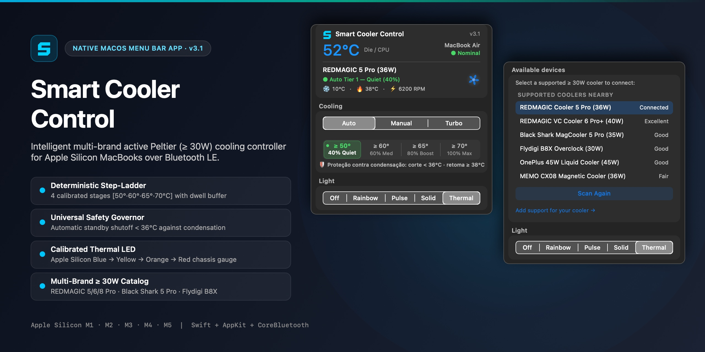
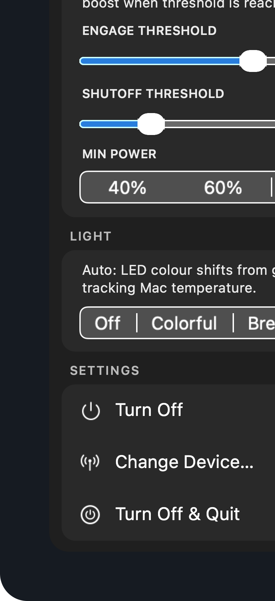
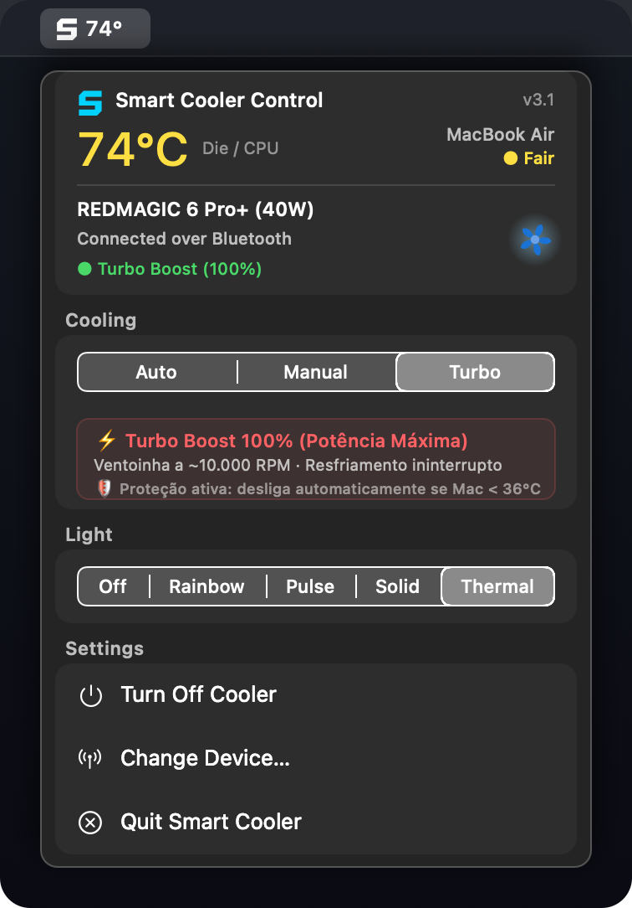
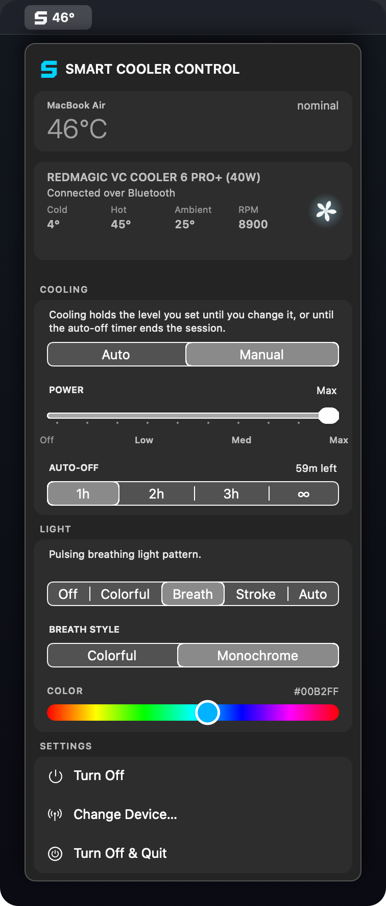
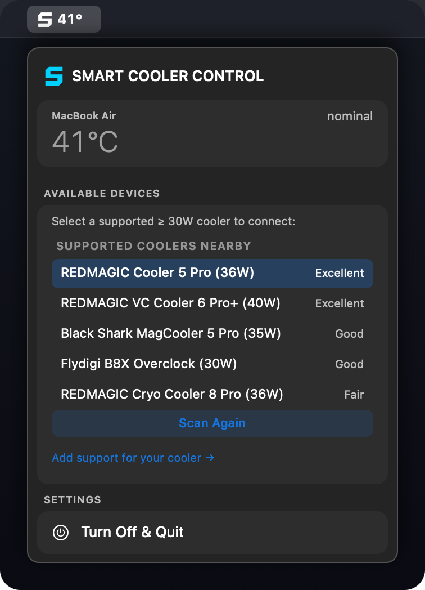

<div align="center">



# Smart Cooler Control for MacBook

**The intelligent, multi-brand active thermoelectric cooling controller for Apple Silicon MacBooks.**  
*Engineered exclusively for high-power external thermoelectric (Peltier) coolers (≥ 30W) to sustain peak performance and eliminate thermal throttling.*

[English](README.md) • [Português (Brasil)](README.pt-BR.md) • [简体中文](README.zh-CN.md)

<br/>

[](docs/GETTING_STARTED.md#requirements)
[](docs/GETTING_STARTED.md#requirements)
[](docs/DEVELOPMENT.md)
[](docs/COMPATIBILITY.md)
[](LICENSE)

</div>

---

## ⚡ Overview

MacBooks powered by Apple Silicon (**M1, M2, M3, M4 across Pro, Max, and Ultra tiers, as well as fanless MacBook Air**) pack desktop-class computing density into sleek aluminum unibodies. However, under sustained compute-heavy workloads — such as **8K ProRes video export, 3D rendering (Blender, Octane, Cinema 4D), local LLM inference (Ollama, LM Studio), Xcode compiling, and gaming** — heat accumulates rapidly in the chassis, leading to thermal throttling and reduced clock frequencies.

Generic 10W–15W smartphone coolers lack the thermal pump capacity to penetrate the aluminum thermal mass of a MacBook. 

**Smart Cooler Control enforces an enthusiast benchmark: ≥ 30W.** It unlocks full hardware control over cutting-edge magnetic thermoelectric (Peltier TEC) coolers equipped with liquid vapor chambers and high-velocity 9,000 RPM blowers, communicating directly over native Bluetooth Low Energy (BLE).

---

## 📸 Screenshots

<div align="center">
<table>
  <tr>
    <td align="center" width="25%">
      
      <br/><b>Smart Max Profile</b><br/>
      <sub>Immediate 100% boost at engage threshold</sub>
    </td>
    <td align="center" width="25%">
      
      <br/><b>Balanced Profile</b><br/>
      <sub>Smooth acoustic ramp from min power</sub>
    </td>
    <td align="center" width="25%">
      
      <br/><b>Manual Precision Mode</b><br/>
      <sub>Step slider, timers & RGB spectrum</sub>
    </td>
    <td align="center" width="25%">
      
      <br/><b>Multi-Brand Discovery</b><br/>
      <sub>Isolated ≥ 30W BLE driver catalog</sub>
    </td>
  </tr>
</table>
</div>

---

## 🚀 Key Features

### 🧠 Deterministic 4-Stage Step-Ladder Autopilot (v3.1)
- **Engineered for Apple Silicon:** Replaces unpredictable continuous curves with 4 deterministic stages calibrated for M1–M4 thermal dynamics:
  - **Standby (< 50°C):** 0% fan / 0W TEC during quiet idle tasks.
  - **Tier 1 — Quiet (≥ 50°C):** 40% fan (`.low`) with release below 42°C.
  - **Tier 2 — Balanced (≥ 60°C):** 60% fan (`.medium`) with release below 55°C.
  - **Tier 3 — Boost (≥ 65°C):** 80% fan (`.medium`) with release below 61°C.
  - **Tier 4 — Turbo (≥ 70°C):** 100% fan (`.max`) with release below 66°C for peak thermal defense.
- **Asymmetric Hysteresis & Dynamic Dwell:** Instant step-up on thermal spikes; 20-second dwell buffer on cooldowns to protect Peltier semiconductors from cycling fatigue, with automatic 3-second velocity bypass on rapid thermal drops ($dT/dt \le -3^\circ\text{C/s}$).

### ❄️ Universal Condensation & Frost Safety Governor
- Heavy-duty 30W–45W Peltier coolers can rapidly drop cold-plate temperatures below freezing ($< 0^\circ\text{C}$).
- Smart Cooler Control enforces a hardware-grade safety interlock across **ALL modes** (Auto, Manual, and Turbo):
  - **Hard Cutoff:** Instantly cuts power to Standby (0% fan / 0W) if die temperature drops below **`< 36.0°C`**.
  - **Anti-Hunting Re-Arm:** Stays in Standby until die temperature rises safely back to **`≥ 38.0°C`**.

### ⚙️ Tri-Mode Precision Control
- **Auto:** Fully autonomous Step-Ladder Autopilot with safety governor and live status tracking.
- **Manual:** Continuous 10-step fan slider (0% to 100%) for exact tactile airflow and acoustic control.
- **Turbo:** Instant 100% maximum thermal power with active safety cutoff preservation.

### 🌈 Mac Family-Aware Calibrated Thermal LED
- The cooler's RGB LED dynamically tracks Mac die temperature using Apple Silicon-calibrated operating envelopes:
  - **MacBook Air (fanless):** **Blue** (cold/nominal `< 65°C`) $\rightarrow$ **Yellow** (moderate `65°C–75°C`) $\rightarrow$ **Orange** (sustained `75°C–85°C`) $\rightarrow$ **Red** (critical `≥ 88°C`).
  - **MacBook Pro (internal fans):** **Blue** (`< 68°C`) $\rightarrow$ **Yellow** (`68°C–78°C`) $\rightarrow$ **Orange** (`78°C–88°C`) $\rightarrow$ **Red** (`≥ 90°C`).
  - **Mac Studio / Mac mini / Mac Pro:** **Blue** (`< 58°C`) $\rightarrow$ **Yellow** (`58°C–68°C`) $\rightarrow$ **Orange** (`68°C–78°C`) $\rightarrow$ **Red** (`≥ 85°C`).
- **Standby Persistence:** Retains calm nominal blue LED during 0% fan standby instead of reverting to vendor red alerts.

### 🛡️ Native macOS Lifecycle & Sleep Integration
- Listens to `NSWorkspace` notifications: instantly powers down the cooler on **System Sleep** (`willSleepNotification`) and **Shutdown** (`willPowerOffNotification`), and resumes cooling seamlessly upon **Wake** (`didWakeNotification`).
- Background auto-reconnect on application launch.

---

## 🔌 Supported Coolers Catalog (≥ 30W Standard)

Strict driver isolation ensures every supported brand connects through dedicated GATT protocols without packet collisions:

| Brand | Model | Peak Power | Architecture | Status |
| :--- | :--- | :---: | :--- | :---: |
| **REDMAGIC** | **VC Cooler 6 Pro+** | **40W** | Liquid Vapor Chamber + Overclock TEC | ✅ Supported |
| **REDMAGIC** | **Magnetic Cooler 5 Pro** | **36W** | Custom 3D VC + Peltier TEC (9000 RPM) | ✅ Supported & Verified |
| **REDMAGIC** | **VC Cooler 6 Pro** | **36W** | Liquid Vapor Chamber + Peltier TEC | ✅ Supported & Verified |
| **REDMAGIC** | **Cryo Cooler 8 Pro** | **36W** | 4th-Gen Custom Cryo TEC | ✅ Supported |
| **REDMAGIC** | **Magcooler 4 Pro** | **27W** | High-Power Magnetic TEC | ✅ Supported |
| **Black Shark** | **MagCooler 5 Pro** | **35W** | 5-Step Custom TEC (5100 RPM) | ✅ Supported |
| **Black Shark** | **MagCooler 4 Pro** | **27W** | Dual-Channel Power + Fan | ✅ Supported |
| **Flydigi** | **Flydigi B8X** | **30W** | Overclock Frequency Converter TEC | ✅ Supported |
| **Flydigi** | **Flydigi B7X** | **27W** | Smart Frequency Magnetic TEC | ✅ Supported |
| **MEMO** | **CX08 / CX07** | **30W–36W** | High-Power Magnetic Gaming Cooler | ✅ Supported |
| **iQOO** | **Cooling Back Clip 2 Pro** | **27W–33W** | Dual-TEC Semi-Conductor Clip | 🔄 Protocol Extraction |
| **OnePlus** | **45W Liquid Cooler** | **45W** | External Radiator + Water Pump TEC | 🔄 Protocol Extraction |

---

## 🛠️ Installation & Building

### Requirements
- macOS 13.0 (Ventura), macOS 14.0 (Sonoma), or macOS 15.0 (Sequoia)+.
- Apple Silicon Mac (`arm64`): M1, M2, M3, M4, M5 (Base, Pro, Max, Ultra).
- Bluetooth enabled with permission granted.

### Build from Source
```bash
# Clone the repository
git clone https://github.com/Despensativo/redmagic-cooler-mac.git
cd redmagic-cooler-mac

# Compile and stage the native application
./build.sh --run
```
The build script generates a signed, self-contained `/Applications/Smart Cooler Control.app` with zero third-party dependencies.

---

## 🔍 Architecture Overview

Smart Cooler Control is built strictly with Apple-native technologies (**Swift, AppKit, and CoreBluetooth**):
- **`src-swift/BLE/`**: Vendor-isolated drivers (`RedMagicDriver`, `BlackSharkDriver`, `FlydigiDriver`, `MemoDriver`) inheriting from `CoolerDriver`.
- **`src-swift/Core/AutopilotPolicy.swift`**: Math engine defining cutoff zones, minimum fan baselines, and thermal ramps.
- **`src-swift/Core/ThermalMonitor.swift`**: Reads macOS Apple Silicon die sensors directly via private IOKit temperature channels with zero CPU overhead.
- **`src-swift/UI/`**: Pixel-perfect custom AppKit views styled for macOS Dark Mode with live animations.

---

## 🏷️ Keywords & Indexing Tags

`macos` • `apple-silicon` • `macbook-pro` • `macbook-air` • `m1` • `m2` • `m3` • `m4` • `thermal-throttling` • `active-cooling` • `peltier-cooler` • `thermoelectric-cooling` • `redmagic-cooler` • `redmagic-5-pro` • `vc-cooler-6-pro` • `black-shark-cooler` • `flydigi-b8x` • `corebluetooth` • `swift` • `appkit` • `menu-bar-app` • `hardware-monitor` • `fan-control`

---

## 🤖 Cooler Not Working? AI-Assisted Fix & Diagnostic Report

Because Bluetooth cooler manufacturers frequently release new hardware revisions or change GATT characteristic UUIDs across firmware updates, your cooler might connect without responding or might not be recognized yet.

You can use any AI assistant (**Claude, ChatGPT, Gemini, Cursor, or Antigravity**) to diagnose and fix your cooler locally in minutes:

### 1. Collect your device log
Connect or scan for your cooler in the app, then run this command in Terminal to inspect the last 50 log lines:
```bash
tail -n 50 ~/.cooler.log
```

### 2. Copy & paste this prompt into your AI assistant
```text
I am using the open-source macOS app "Smart Cooler Control" (https://github.com/Despensativo/redmagic-cooler-mac).
My cooler is not responding properly or is not yet supported.

Architecture context:
- Device profiles and BLE matching rules live in `src-swift/BLE/DeviceProfile.swift`.
- Brand-isolated GATT drivers live in `src-swift/BLE/Drivers/` (`RedMagicDriver.swift`, `BlackSharkDriver.swift`, `FlydigiDriver.swift`, `MemoDriver.swift`, `OnePlusDriver.swift`, `IQOODriver.swift`).
- After editing, the app compiles and runs via `./build.sh --run`.

Here is my cooler model and the output from `~/.cooler.log`:
- Cooler Brand & Model: [INSERT MODEL NAME & WATTAGE]
- What happens: [e.g., Not found in scan / Connects but fan doesn't spin / LED doesn't change]
- Log output (`~/.cooler.log`):
[PASTE OUTPUT OF tail -n 50 ~/.cooler.log HERE]

Please:
1. Analyze the advertised BLE name, Service UUIDs, Characteristic UUIDs, and raw hex payloads in the log.
2. Identify the root cause and provide the exact Swift code changes in `DeviceProfile.swift` and the corresponding driver so I can test the fix locally with `./build.sh --run`.
3. Generate a concise Technical Summary (Advertised Name, Service/Char UUIDs, Command Hex Format, and Patch Diff) that I can email to the maintainer.
```

### 3. Send us the report so we can update the official app!
Whether the AI helped you find the working fix or you just have the diagnostic log, please send the summary to:
- 📧 **Email:** [despensativo@gmail.com](mailto:despensativo@gmail.com?subject=Smart%20Cooler%20Control%20-%20Device%20Report%20%2F%20Fix)
- 🐛 **GitHub Issues / PR:** [Open an Issue or Pull Request](https://github.com/Despensativo/redmagic-cooler-mac/issues)

We will review your report and include official native support for your cooler in the next release!

---

## 🙏 Credits & Acknowledgments

**Smart Cooler Control** is an independent multi-brand thermal management platform engineered for high-power (≥ 30W) thermoelectric coolers on Apple Silicon. Special thanks to [@hajarrashidi](https://github.com/hajarrashidi/redmagic-cooler-mac) for the initial single-device REDMAGIC 6 Pro macOS foundation from which this project evolved.

---

## 📄 License

This project is licensed under the [MIT License](LICENSE).
