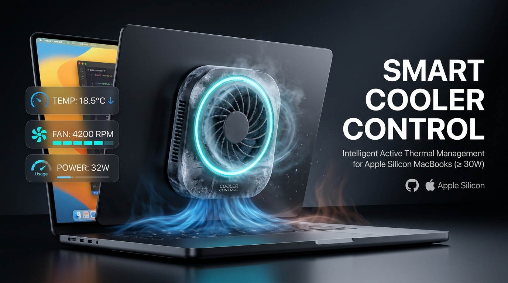
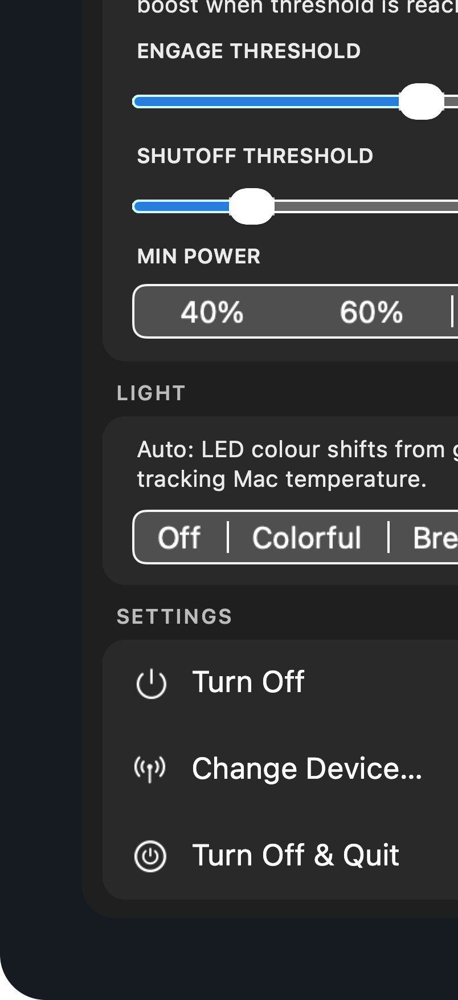
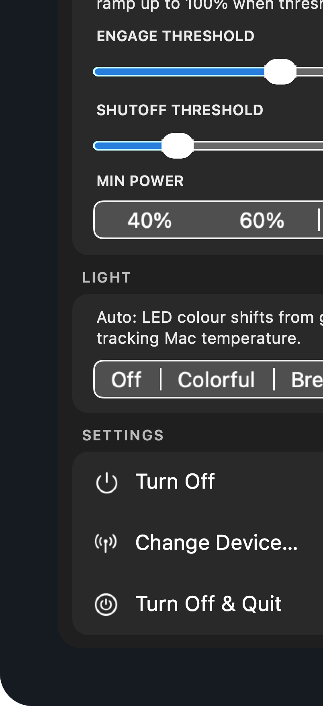
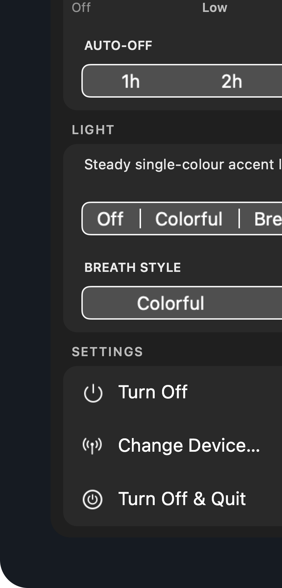

<div align="center">



# Smart Cooler Control para MacBook

**O controlador inteligente e multimarca de resfriamento ativo termoelétrico para MacBooks com Apple Silicon.**  
*Desenvolvido exclusivamente para coolers externos termoelétricos (Peltier) de alta potência (≥ 30W), eliminando o estrangulamento térmico (thermal throttling) e mantendo o desempenho máximo sustentado.*

[English](README.md) • [Português (Brasil)](README.pt-BR.md) • [简体中文](README.zh-CN.md)

<br/>

[](docs/GETTING_STARTED.md#requirements)
[](docs/GETTING_STARTED.md#requirements)
[](docs/DEVELOPMENT.md)
[](docs/COMPATIBILITY.md)
[](LICENSE)

</div>

---

## ⚡ Por que o Smart Cooler Control?

Os MacBooks equipados com Apple Silicon (**M1, M2, M3, M4 nas versões Base, Pro, Max e Ultra, além do MacBook Air sem ventoinha**) entregam uma densidade de processamento incomparável em chassis finos de alumínio. No entanto, sob cargas de trabalho intensas e contínuas — como **renderização 3D (Blender, Octane), exportação de vídeo em 8K ProRes, inferência local de IA (Ollama, LM Studio), compilação no Xcode e jogos** —, o calor se acumula na estrutura de alumínio, provocando queda de clock por proteção térmica (*thermal throttling*).

Coolers comuns de celular de **10W a 15W** não têm potência de bombeamento de calor suficiente para penetrar a inércia térmica do chassi do MacBook.

**O Smart Cooler Control estabelece um padrão rigoroso: ≥ 30W.** Ele desbloqueia o controle total de coolers magnéticos de alta performance equipados com câmara de vapor (Vapor Chamber), pastilhas termoelétricas Peltier (TEC) e ventiladores de até 9.000 RPM, comunicando-se diretamente via Bluetooth Low Energy (BLE) nativo no macOS.

---

## 📸 Demonstração da Interface

<div align="center">
<table>
  <tr>
    <td align="center" width="33%">
      
      <br/><b>Perfil Smart Max</b><br/>
      <sub>Salto imediato para 100% no limiar de engate</sub>
    </td>
    <td align="center" width="33%">
      
      <br/><b>Perfil Balanced</b><br/>
      <sub>Rampa acústica suave e progressiva</sub>
    </td>
    <td align="center" width="33%">
      
      <br/><b>Modo Manual de Precisão</b><br/>
      <sub>Controle deslizante e temporizador automático</sub>
    </td>
  </tr>
</table>
</div>

---

## 🚀 Principais Recursos

### 🧠 Piloto Automático Térmico Dinâmico (Thermal Autopilot)
- **Perfil Smart Max:** Mantém uma potência mínima silenciosa (`[40%] [60%] [80%] [100%]`) em tarefas cotidianas. No instante em que a temperatura do processador cruza o **Limiar de Engate** configurado (ex: $\ge 50^\circ\text{C}$), o sistema injeta imediatamente 100% de resfriamento.
- **Perfil Balanced:** Mantém o ventilador na rotação mínima configurada enquanto a máquina está fria e executa uma aceleração progressiva e suave conforme a temperatura sobe.

### ❄️ Prevenção Ativa Contra Condensação e Gelo
- Coolers potentes de 36W a 40W conseguem atingir temperaturas negativas ($< 0^\circ\text{C}$) na face fria. Se o Mac estiver ocioso ou frio, isso pode condensar a umidade do ar sobre o chassi.
- O **Limiar de Desligamento (Shutoff)** corta automaticamente a pastilha e o ventilador para 0% (Standby) quando o Mac atinge uma temperatura fria e segura (ex: $< 38^\circ\text{C}$).
- Sliders totalmente desacoplados e independentes: ajustar o *Shutoff* nunca empurra nem desregula o *Engage*.

### ⚙️ MIN POWER Calibrado para o Hardware Real
- Motores sem escovas (brushless) de 9.000 RPM possuem limite de torque físico abaixo de 40% de ciclo de trabalho PWM.
- Em vez de opções fictícias como 20% ou 30% que causavam ruído idêntico ou paradas de ventoinha, o aplicativo adota degraus uniformes e audíveis: **`[40%] [60%] [80%] [100%]`**.

### 🌈 LED Térmico Calibrado por Família de Mac
- O LED do cooler muda de cor em tempo real de acordo com a temperatura interna: **Verde** (frio/ideal) $\rightarrow$ **Amarelo/Âmbar** (carga moderada) $\rightarrow$ **Vermelho Alerta** (alta temperatura / throttling).
- Perfis térmicos reais por hardware:
  - **MacBook Air:** Curva otimizada para chassi passivo sem ventoinha ($35^\circ\text{C}\dots55^\circ\text{C}$ verde, $>80^\circ\text{C}$ vermelho).
  - **MacBook Pro:** Considera o acionamento das ventoinhas internas ($38^\circ\text{C}\dots58^\circ\text{C}$ verde, $>82^\circ\text{C}$ vermelho).
  - **Mac Studio / Mac mini / Mac Pro:** Faixa térmica mais baixa para desktops ($30^\circ\text{C}\dots50^\circ\text{C}$ verde, $>72^\circ\text{C}$ vermelho).

### 🛡️ Integração Nativa com o Ciclo de Vida do macOS
- Monitora os eventos do sistema via `NSWorkspace`: desliga o cooler imediatamente ao **Suspender / Repouso** (`willSleepNotification`) e ao **Desligar** (`willPowerOffNotification`), e retoma o resfriamento ao **Acordar** (`didWakeNotification`).
- Reconexão automática em segundo plano ao abrir o aplicativo.

---

## 🔌 Catálogo de Coolers Homologados (Padrão ≥ 30W)

Arquitetura com isolamento de driver: cada fabricante opera em classes dedicadas, eliminando risco de contaminação de comandos BLE:

| Marca | Modelo | Potência Máxima | Arquitetura | Status |
| :--- | :--- | :---: | :--- | :---: |
| **REDMAGIC** | **VC Cooler 6 Pro+** | **40W** | Câmara de Vapor Líquida + Overclock TEC | ✅ Suportado |
| **REDMAGIC** | **Magnetic Cooler 5 Pro** | **36W** | Câmara de Vapor 3D + Pastilha TEC (9.000 RPM) | ✅ Suportado e Validado |
| **REDMAGIC** | **VC Cooler 6 Pro** | **36W** | Câmara de Vapor + Pastilha TEC | ✅ Suportado e Validado |
| **REDMAGIC** | **Cryo Cooler 8 Pro** | **36W** | Pastilha Criogênica Customizada 4ª Geração | ✅ Suportado |
| **REDMAGIC** | **Magcooler 4 Pro** | **27W** | Pastilha Magnética Alta Potência | ✅ Suportado |
| **Black Shark** | **MagCooler 5 Pro** | **35W** | TEC Customizada de 5 Estágios (5.100 RPM) | ✅ Suportado |
| **Black Shark** | **MagCooler 4 Pro** | **27W** | Canal Duplo de Potência + Ventilador | ✅ Suportado |
| **Flydigi** | **Flydigi B8X** | **30W** | TEC com Modo Overclock por Conversor | ✅ Suportado |
| **Flydigi** | **Flydigi B7X** | **27W** | Pastilha Magnética com Frequência Inteligente | ✅ Suportado |
| **MEMO** | **CX08 / CX07** | **30W–36W** | Cooler Gamer Magnético de Alta Potência | ✅ Suportado |
| **iQOO** | **Cooling Back Clip 2 Pro** | **27W–33W** | Clipe Duplo com Semicondutor | 🔄 Extração de Protocolo |
| **OnePlus** | **45W Liquid Cooler** | **45W** | Radiador Externo + Bomba d'Água TEC | 🔄 Extração de Protocolo |

---

## 🛠️ Como Instalar e Compilar

### Requisitos do Sistema
- macOS 13.0 (Ventura), macOS 14.0 (Sonoma) ou macOS 15.0 (Sequoia) ou superior.
- Mac com processador Apple Silicon (`arm64`): M1, M2, M3, M4, M5 (Base, Pro, Max ou Ultra).
- Bluetooth ativado e com permissão concedida.

### Compilação Local
```bash
# Clone o repositório
git clone https://github.com/Despensativo/redmagic-cooler-mac.git
cd redmagic-cooler-mac

# Compile e instale automaticamente em /Applications
./build.sh --run
```
O script compila o executável nativo em Swift, assina o pacote localmente e instala `/Applications/Smart Cooler Control.app` sem nenhuma dependência externa ou gerenciador de pacotes pesado.

---

## 🏷️ Palavras-Chave para Indexação (SEO)

`cooler-macbook` • `apple-silicon-cooling` • `macbook-pro-m3` • `macbook-air-m2` • `resfriamento-ativo-mac` • `thermal-throttling-mac` • `cooler-redmagic-mac` • `redmagic-5-pro` • `vc-cooler-6-pro` • `black-shark-cooler` • `flydigi-b8x` • `cooler-peltier-mac` • `swift-macos` • `appkit` • `corebluetooth` • `menu-bar-mac` • `controle-ventoinha-mac`

---

## 📄 Licença

Este projeto está licenciado sob a licença de código aberto [MIT](LICENSE).
