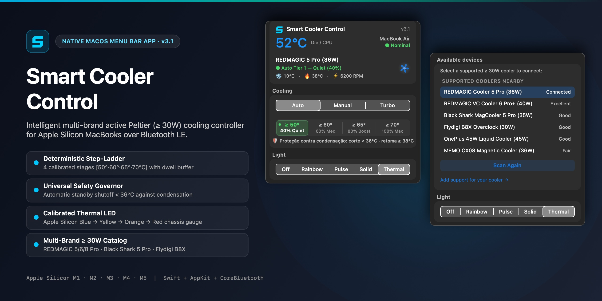
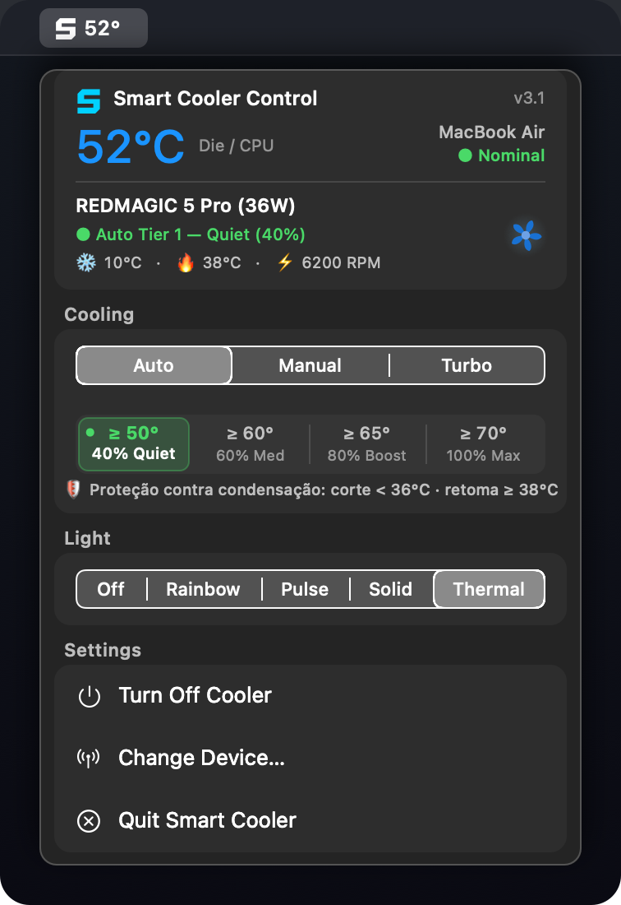
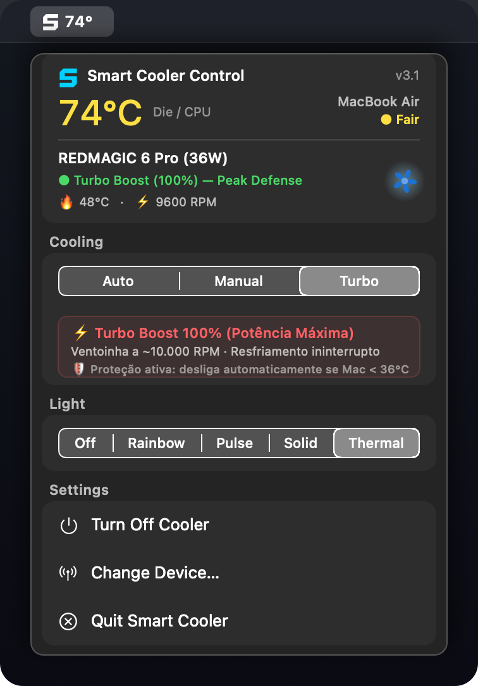
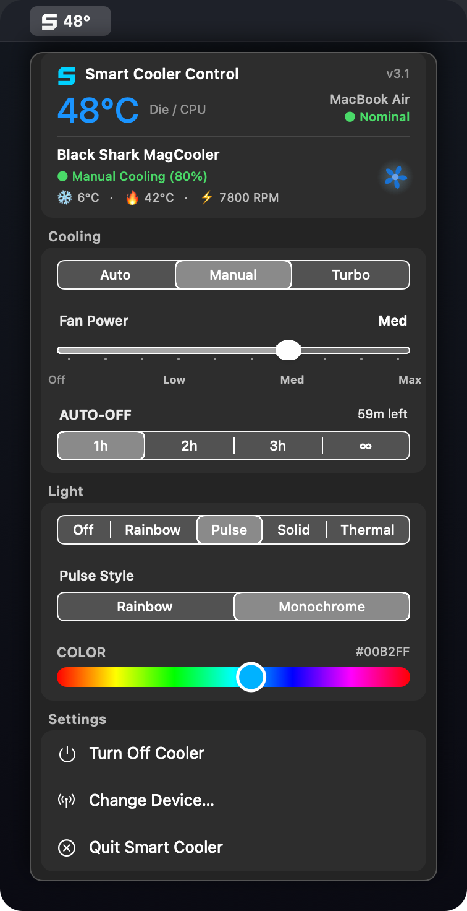
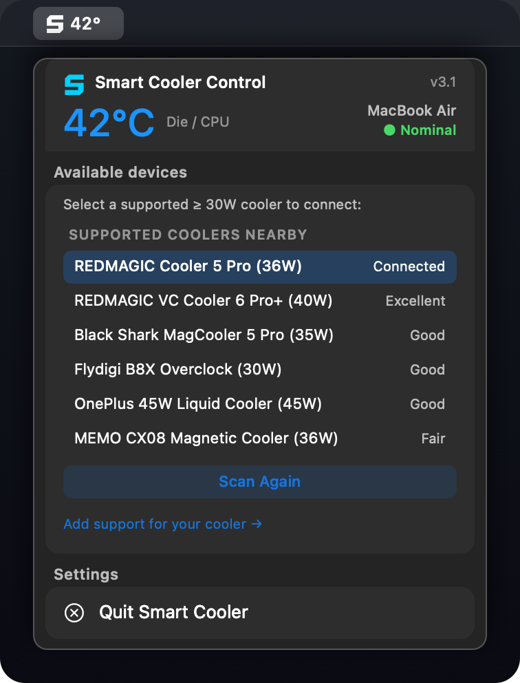

<div align="center">



# Smart Cooler Control for MacBook (苹果电脑智能散热器控制)

**专为搭载 Apple Silicon 芯片的 MacBook 设计的智能多品牌主动半导体制冷散热器控制系统。**  
*专为大功率外置磁吸半导体（Peltier/TEC）散热器（≥ 30W）深度优化，彻底消除高负载发热降频，释放 M 系列芯片持久峰值性能。*

[English](README.md) • [Português (Brasil)](README.pt-BR.md) • [简体中文](README.zh-CN.md)

<br/>

[](docs/GETTING_STARTED.md#requirements)
[](docs/GETTING_STARTED.md#requirements)
[](docs/DEVELOPMENT.md)
[](docs/COMPATIBILITY.md)
[](LICENSE)

</div>

---

## ⚡ 为什么需要 Smart Cooler Control？

搭载 Apple Silicon 芯片（**M1、M2、M3、M4，涵盖标准版、Pro、Max、Ultra 以及无风扇 MacBook Air**）的 Mac 拥有极高能效比。但在持续高负载场景下——如 **8K ProRes 视频渲染导出、Blender/Cinema 4D 三维渲染、本地大语言模型推理（Ollama、LM Studio）、Xcode 大型项目编译以及高画质游戏**，铝合金机身会快速积热，导致芯片保护性降频，性能断崖式下跌。

市面上常见的 **10W 至 15W** 便携式手机散热背夹，制冷量根本无法穿透 MacBook 厚实的实心铝合金外壳。

**Smart Cooler Control 确立了严苛的发烧级标准：≥ 30W。** 释放配备液冷均热板（Vapor Chamber）、大面积定制半导体制冷片（TEC）与高达 9,000 转高速离心涡轮风扇的真正冷却潜力，通过 macOS 原生蓝牙低功耗（BLE）进行毫秒级直连调控。

---

## 📸 软件界面预览

<div align="center">
<table>
  <tr>
    <td align="center" width="25%">
      
      <br/><b>Step-Ladder 阶梯模式</b><br/>
      <sub>4 档精准调校与滞后防抖缓冲</sub>
    </td>
    <td align="center" width="25%">
      
      <br/><b>Turbo 极速模式</b><br/>
      <sub>100% 满血极速爆发与防冷凝保护</sub>
    </td>
    <td align="center" width="25%">
      
      <br/><b>Manual 手动档位模式</b><br/>
      <sub>10 级滑块、定时器与全彩灯效</sub>
    </td>
    <td align="center" width="25%">
      
      <br/><b>多品牌设备发现</b><br/>
      <sub>≥ 30W 专属蓝牙驱动隔离名录</sub>
    </td>
  </tr>
</table>
</div>

---

## 🚀 核心功能亮点

### 🧠 Step-Ladder 四阶确定性智能温控 (v3.1)
- **专为 Apple Silicon 定制：** 彻底淘汰不可控的连续曲线，采用专为 M1–M4 芯片热工特性设计的 4 级确定性阶梯温控：
  - **待机 Standby (< 50°C):** 0% 转速 / 0W TEC 极度静音。
  - **Tier 1 — Quiet (≥ 50°C):** 40% 风速 (`.low`)，降至 42°C 以下平稳退出。
  - **Tier 2 — Balanced (≥ 60°C):** 60% 风速 (`.medium`)，降至 55°C 以下退出。
  - **Tier 3 — Boost (≥ 65°C):** 80% 风速 (`.medium`)，降至 61°C 以下退出。
  - **Tier 4 — Turbo (≥ 70°C):** 100% 风速 (`.max`)，高负载压制降频。
- **非对称滞后与动态 Dwell 缓冲：** 升温瞬时直达，降速设 20 秒稳定缓冲防止半导体反复冷热冲击，检测到急速降温时 3 秒智能快速旁路。

### ❄️ 全局防冷凝与结霜保护阀 (Universal Governor)
- 30W 至 45W 强力半导体制冷片在芯片低温时极易使接触面降至冰点以下（$< 0^\circ\text{C}$）。
- Smart Cooler Control 在**所有模式**（Auto、Manual、Turbo）下强制执行硬件级断电保护：
  - **强制断电：** 芯片核心温度低于 **`< 36.0°C`** 时瞬间切断制冷并停转。
  - **防抖重新激活：** 待机直到芯片温度平稳回升至 **`≥ 38.0°C`** 方可再次运转。

### ⚙️ 三模精准操控体系 (Tri-Mode)
- **Auto：** 4 阶确定性 Step-Ladder 阶梯全自主巡航。
- **Manual：** 10 级无级触感档位滑块（0% 至 100%）与定时关机。
- **Turbo：** 一键开启 100% 满血暴力压制，并全程维持防冷凝保护。

### 🌈 适配 Mac 全系机型的智能温控氛围灯
- 氛围灯精准映射 Apple Silicon 真实工作温度区间：
  - **MacBook Air (无风扇):** **冷蓝** (低温正常 `< 65°C`) $\rightarrow$ **暖黄** (`65°C–75°C`) $\rightarrow$ **橙色** (`75°C–85°C`) $\rightarrow$ **警示鲜红** (`≥ 88°C`).
  - **MacBook Pro (内置风扇):** **冷蓝** (`< 68°C`) $\rightarrow$ **暖黄** (`68°C–78°C`) $\rightarrow$ **橙色** (`78°C–88°C`) $\rightarrow$ **警示鲜红** (`≥ 90°C`).
  - **Mac Studio / Mac mini / Mac Pro:** **冷蓝** (`< 58°C`) $\rightarrow$ **暖黄** (`58°C–68°C`) $\rightarrow$ **橙色** (`68°C–78°C`) $\rightarrow$ **警示鲜红** (`≥ 85°C`).
- **待机保持：** 在 0% 停转待机时持续保持静谧冷蓝灯光，杜绝原厂固件报红警示。

### 🛡️ 原生深入 macOS 系统电源生命周期
- 完美监听 macOS `NSWorkspace` 生命周期：Mac 睡眠合盖（`willSleepNotification`）或关机（`willPowerOffNotification`）时立即自动关闭散热器，唤醒亮屏（`didWakeNotification`）时自动恢复智控。
- 启动静默后台自动回连。

---

## 🔌 支持的大功率散热器名录 (≥ 30W 标准)

具备严格的驱动隔离机制，各品牌使用专属 GATT 特征协议，彻底杜绝数据包误发：

| 品牌 | 型号 | 额定峰值功率 | 架构与散热技术 | 适配状态 |
| :--- | :--- | :---: | :--- | :---: |
| **红魔 (REDMAGIC)** | **散热器 6 Pro+** | **40W** | 液冷均热板 VC + 超频大半导体 | ✅ 原生驱动支持 |
| **红魔 (REDMAGIC)** | **磁吸散热器 5 Pro** | **36W** | 3D 立体 VC 均热板 + 9000 转风机 | ✅ 硬件真机实测完美 |
| **红魔 (REDMAGIC)** | **VC 散热器 6 Pro** | **36W** | 均热板 VC + 定制大半导体 | ✅ 硬件真机实测完美 |
| **红魔 (REDMAGIC)** | **低温散热器 8 Pro** | **36W** | 第四代定制超导冷冻 TEC | ✅ 原生驱动支持 |
| **红魔 (REDMAGIC)** | **散热器 4 Pro** | **27W** | 大功率磁吸半导体 | ✅ 原生驱动支持 |
| **黑鲨 (Black Shark)** | **磁吸散热背夹 5 Pro** | **35W** | 5 档定制 TEC (5100 RPM) | ✅ 原生驱动支持 |
| **黑鲨 (Black Shark)** | **磁吸散热器 4 Pro** | **27W** | 双路供电与风量控制 | ✅ 原生驱动支持 |
| **飞智 (Flydigi)** | **飞智 B8X** | **30W** | 超频变频制冷片 | ✅ 原生驱动支持 |
| **飞智 (Flydigi)** | **飞智 B7X** | **27W** | 变频控温磁吸散热背夹 | ✅ 原生驱动支持 |
| **美莫 (MEMO)** | **CX08 / CX07** | **30W–36W** | 大功率电竞磁吸散热器 | ✅ 原生驱动支持 |
| **iQOO** | **散热背夹 2 Pro** | **27W–33W** | 双半导体制冷片双夹具 | 🔄 协议解析提取中 |
| **一加 (OnePlus)** | **45W 液冷散热背夹** | **45W** | 外置水冷泵箱 + 半导体 | 🔄 协议解析提取中 |

---

## 🛠️ 安装与编译指南

### 系统要求
- macOS 13.0 (Ventura)、macOS 14.0 (Sonoma)、macOS 15.0 (Sequoia) 或更高版本。
- 搭载 Apple Silicon 芯片的 Mac 电脑（`arm64` 架构：M1、M2、M3、M4、M5，包含标准版、Pro、Max、Ultra）。
- 已开启蓝牙并授予蓝牙权限。

### 本地源码编译
```bash
# 克隆仓库
git clone https://github.com/Despensativo/redmagic-cooler-mac.git
cd redmagic-cooler-mac

# 编译并自动安装至 /Applications 目录
./build.sh --run
```
编译脚本将自动输出完全独立无外部臃肿依赖的 `/Applications/Smart Cooler Control.app`。

---

## 🏷️ 关键词与索引标签 (SEO)

`mac-cooler` • `macbook-cooling` • `apple-silicon` • `macbook-pro-m3` • `macbook-air-m2` • `thermal-throttling` • `redmagic-mac` • `redmagic-cooler-5pro` • `vc-cooler-6-pro` • `black-shark-cooler` • `flydigi-b8x` • `peltier-cooling` • `半导体制冷` • `红魔散热器mac` • `黑鲨散热器mac` • `飞智b8x` • `mac状态栏应用` • `swift-macos`

---

## 🤖 散热器未响应或暂未支持？AI 辅助修复与问题反馈

由于各品牌蓝牙散热器在不同批次或固件版本中可能会更改广播名称或 GATT 特征 UUID，您的散热器可能会出现连接后不响应或暂未被识别的情况。

您可以直接使用任意 AI 模型（**Claude、ChatGPT、Gemini、Cursor 或 Antigravity**）快速分析日志并提取修复方案：

### 1. 获取本地蓝牙诊断日志
在软件中扫描或连接您的散热器后，打开终端（Terminal）运行以下命令获取最近 50 行日志：
```bash
tail -n 50 ~/.cooler.log
```

### 2. 复制以下提示词（Prompt）发送给 AI 助手
```text
我正在使用 macOS 开源项目 "Smart Cooler Control" (https://github.com/Despensativo/redmagic-cooler-mac)。
我的蓝牙散热器目前无法正常响应或尚未被识别。

项目架构背景：
- 设备配置与蓝牙匹配规则位于 `src-swift/BLE/DeviceProfile.swift`。
- 各品牌独立 GATT 驱动位于 `src-swift/BLE/Drivers/`（`RedMagicDriver.swift`、`BlackSharkDriver.swift`、`FlydigiDriver.swift`、`MemoDriver.swift`、`OnePlusDriver.swift`、`IQOODriver.swift`）。
- 修改代码后可通过 `./build.sh --run` 直接编译并运行测试。

以下是我的散热器型号与 `~/.cooler.log` 日志内容：
- 散热器品牌与型号：[填写品牌、型号及功率]
- 遇到的现象：[例如：扫描不到 / 连接成功但风扇不转 / 灯光无法调节]
- 日志输出 (`~/.cooler.log`)：
[在此粘贴 tail -n 50 ~/.cooler.log 的输出内容]

请你：
1. 分析日志中的 BLE 广播名称、Service UUID、Characteristic UUID 以及原始十六进制数据包。
2. 找出原因并给出 `DeviceProfile.swift` 及对应驱动的具体 Swift 修改代码，方便我通过 `./build.sh --run` 本地验证。
3. 生成一份结构化的【技术诊断摘要】（包含广播名、UUID 列表、指令格式与代码 Diff），以便我发送给项目维护者合并更新。
```

### 3. 提交报告或发送邮件，帮助我们更新官方版本！
无论您通过 AI 成功验证了修复方案，还是仅希望提交诊断日志由我们协助适配，欢迎通过以下方式联系：
- 📧 **发送邮件：** [despensativo@gmail.com](mailto:despensativo@gmail.com?subject=Smart%20Cooler%20Control%20-%20Device%20Report%20%2F%20Fix)
- 🐛 **GitHub Issues / PR：** [提交 Issue 或 Pull Request](https://github.com/Despensativo/redmagic-cooler-mac/issues)

收到您的反馈后，我们将第一时间完成适配并合并至下一版官方更新中！

---

## 🙏 致谢与声明

**Smart Cooler Control** 是一个全新的独立多品牌大功率（≥ 30W）半导体制冷管理平台。特别感谢 [@hajarrashidi](https://github.com/hajarrashidi/redmagic-cooler-mac) 早期针对单款红魔 6 Pro 散热器提供的基础项目启发。

---

## 📄 开源许可证

本项目基于 [MIT 许可证](LICENSE) 开放源代码。
